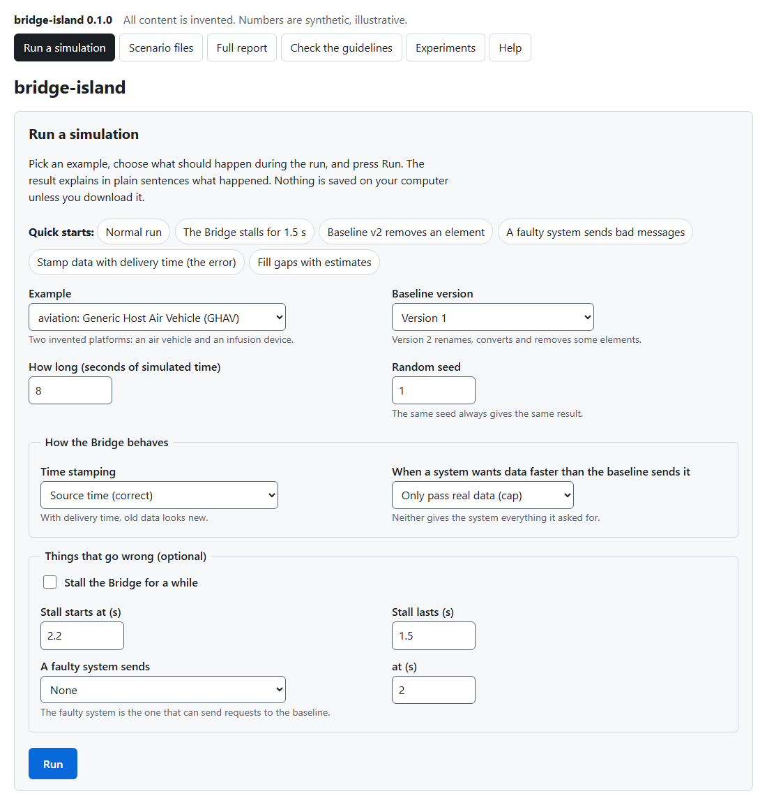
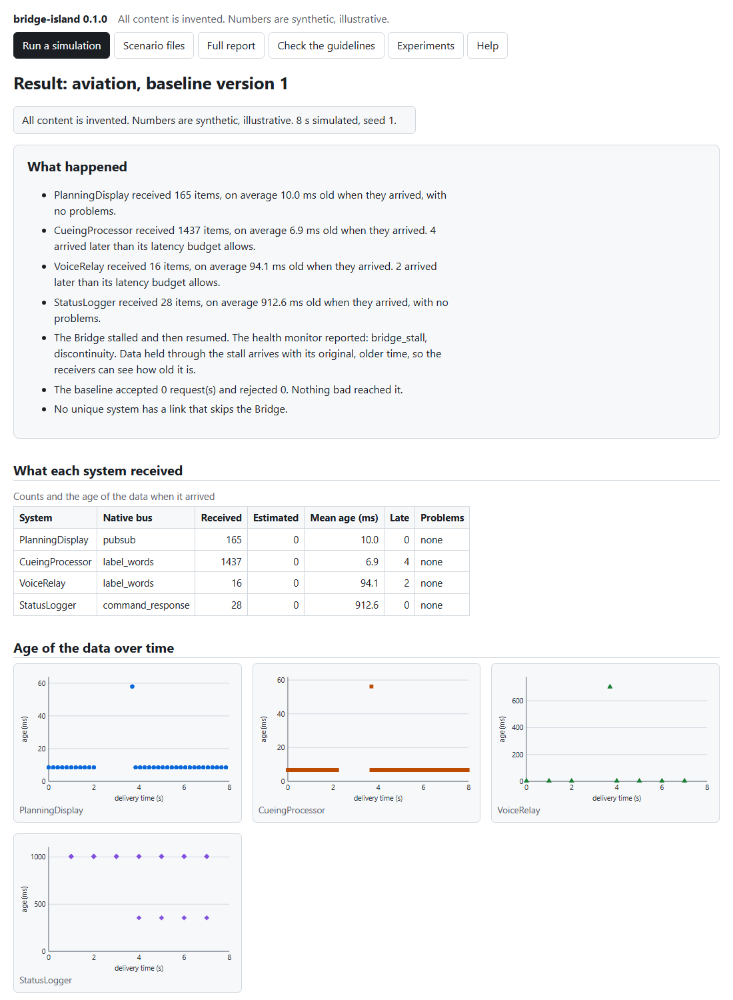

# Using the app (no command line)

bridge-island has a point-and-click app that opens in your web browser. You choose what should
happen in a simulated run, press a button, and get the result explained in plain sentences, with
tables, charts and downloads. All content is invented and all numbers are synthetic, illustrative.

## Start it

**Windows:** double-click **`Start-bridge-island.bat`** in the project folder. A black window opens
and your browser opens the app. Leave the black window open while you use the app.

To get a shortcut on your desktop, right-click `Start-bridge-island.bat`, choose *Send to*, then
*Desktop (create shortcut)*.

**Any system:** the same thing from a terminal is `uv run bridge-island ui`
(or `python -m bridge_island ui`). Add `--no-browser` if you do not want the browser to open, and
`--port N` to choose the first port to try.

The first time you start it, `uv` may take a minute to set up the project. After that it starts in
a second or two. You need [uv](https://docs.astral.sh/uv/) installed once.

**Stop it** by closing the black window (or pressing Ctrl+C in it).

## What you will see

The page across the top has six tabs.

| Tab | What it is for |
| --- | --- |
| **Run a simulation** | Choose an example, how long to run, how the Bridge behaves, and what goes wrong (a stall, a faulty system). The *Quick starts* fill the form with common cases. |
| **Scenario files** | Run one of the shipped scenarios, or paste your own. A scenario file describes one run completely, so it can be shared and repeated. |
| **Full report** | One page with everything for an example. Open it here, or download it as a single file that works offline. |
| **Check the guidelines** | Runs a test for each of the six design guidelines and says pass or fail, in words. |
| **Experiments** | The four repeatable experiments, with tables, plots and downloadable files. |
| **Help** | Plain-English explanations of every term, how to read the charts, and the scenario file format. |

## Reading a result

* **What happened** comes first, in sentences: what each system received, whether anything was late,
  what the health monitor and the cyber monitor did, and whether anything bad reached the baseline.
* **What each system received** is the same information as a table. *Late* means the data arrived
  older than that system's own latency budget allows.
* **Age of the data over time** has one chart per system. Across is when the data arrived; up is how
  old it was. A dot far above the others is old data. Systems use different marker shapes, and hollow
  markers are estimates, so colour is never the only clue.
* **Keep the results** downloads what you need: the numbers (JSON), every datum (CSV), the settings as
  a scenario file you can run again, and a record of how to reproduce the run.
* The form is repeated under the result, filled in with what you chose, so you can change one thing and
  run again. The same seed always gives the same result.

## Things to try

1. Press *Run* with the defaults. Read *What happened*.
2. Press the quick start **The Bridge stalls for 1.5 s**. Find the sentence about the health monitor, and the
   dot high on the chart for the system that holds data longest.
3. Try **Stamp data with delivery time (the error)**. The stall is still there, but nothing is flagged late,
   because old data now looks new. This is why the design keeps the original time (guideline G3).
4. Try **Baseline v2 removes an element**. One system is told that an input is no longer available, instead
   of quietly going without it.
5. Try **A faulty system sends bad messages**. The Bridge blocks the message and the baseline never sees it.
6. Open **Check the guidelines** and run it on both examples.

## Is it safe?

The app runs only on your own computer. It listens on the loopback address `127.0.0.1`, so other
machines cannot reach it, and it sends nothing anywhere. Every form carries a one-time token for the
session, the address the browser used is checked, and nothing you type is ever used as a file name:
scenarios are chosen from the shipped list or pasted as text, and results are kept in memory and only
written to disk when you press a download button. Do not expose it to a network.

## If it does not start

| What you see | What to do |
| --- | --- |
| "bridge-island could not start" in the black window | Install [uv](https://docs.astral.sh/uv/) and double-click the file again. |
| The browser did not open | Copy the address printed in the black window (it looks like `http://127.0.0.1:8765/`) into your browser. |
| The address in the window is not 8765 | Another program had that port, so the app used the next free one. Use the address it prints. |
| "This page has expired" | The app was restarted. Reload the page and try again. |
| Your security software blocks it | The app only talks to your own computer. Allow Python or uv to run, or run `uv run bridge-island ui` from a terminal. |

The app is for learning, demonstration and research. It is not flight or medical software and is not
certified. See [Design rationale and limitations](rationale.md).
