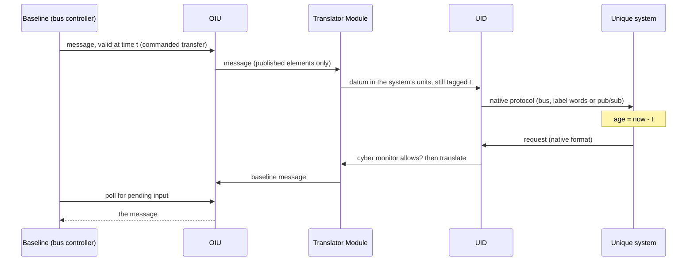

# Concepts

## The two islands

| Term | Meaning |
| --- | --- |
| **Baseline Island** | The host platform. It is immutable to the integrator and certified by another authority. Only its published interface may be used. |
| **Unique Island** | The integrator's own mission systems. Each has its own native interface, protocol, units and rates, and evolves independently. |
| **Bridge** | The single mediation layer. It is the only path between the islands. |
| **Point-to-point (P2P)** | The comparison architecture: each unique system is wired directly to the baseline elements it needs. |

The baseline is certified and owned elsewhere, so the integrator cannot change it. The
unique systems are owned and changed by different teams on different schedules. Without a
mediator, every unique system carries its own copy of the knowledge of how to talk to the
baseline. That knowledge is spread over as many places as there are systems, and each copy
must be updated when the baseline changes.

## The Bridge, and what is in it

The Bridge is one object (`bridge_island.bridge.Bridge`) with five parts.

| Part | Role |
| --- | --- |
| **OEM Interface Unit (OIU)** | Faces the baseline. It follows the baseline's published interface exactly, and acts as a *remote terminal* toward the baseline. |
| **Translator Module (TM)** | Holds all format, content and protocol conversion, and the time-tag handling. |
| **Unique Interface Distributor (UID)** | Keeps a separate connection to each unique system, in that system's own native format. It acts as the *controlling side* toward the unique systems. |
| **Health monitor** | A background service. It detects stale data and stall-and-resume discontinuities, and annunciates them to the affected systems. |
| **Cyber monitor** | A background service. It enforces which data may cross, and in which direction. |



### Role asymmetry

The baseline's bus has a *bus controller* (BC) that starts every transfer, and *remote
terminals* (RTs) that only answer. The OIU is an RT. It cannot push data to the baseline;
it can only hold a message until the baseline polls for it. The baseline stays in control of
its own bus, and the Bridge fits into the role the baseline already defines.

Toward the unique side the roles flip. The UID is the controlling side: bus controller on a
command/response bus, sole transmitter on a label-word bus, publisher on a pub/sub bus. The
Bridge therefore decides when each unique system hears from it, and a unique system cannot
start a conversation with the baseline.

## The six design guidelines

Each guideline is implemented as runtime behavior and checked by tests whose names start
with the guideline number (for example `test_g3_source_time_preserved`).
`bridge-island check-rules` runs the same checks on an example and prints pass or fail.

**G1. Complete retargeting.** No unique system has a direct link to the baseline. The
baseline platform refuses to attach anything that does not declare itself part of a Bridge,
and a network registry records every link so that a bypass can be found by inspection.
Python cannot make a bypass literally impossible for code that lies about what it is, so
the guarantee is "impossible through the public API, and detected otherwise". The P2P
module turns the refusal off on purpose, and the registry then reports one bypass link per
subsystem.

**G2. Translate only where needed.** When the baseline and unique representations of an
element have the same encoding, units and frame, the datum passes through unchanged under
an identity transform. The code generator rejects a mapping that lists a conversion where
none is needed, and rejects one whose conversions do not reach the target representation.

**G3. Time-tag integrity.** Each datum carries the *source* time of validity, never the
Bridge's delivery time. The Bridge adds latency, and a consumer can always compute data age
as `now - source_time`. The Translator Module has a deliberately naive `delivery` mode that
stamps arrival time instead, to show the error: a datum held inside the Bridge for a second
arrives looking brand new.

**G4. Baseline immutability.** The OIU accepts only messages and elements the baseline
publishes, and emits only messages the baseline is specified to accept. Anything else is
rejected and logged inside the Bridge. The Bridge refuses to start if its mapping refers to
an element the baseline does not publish.

**G5. Compiled mapping.** The baseline-to-unique mapping is a YAML spec. `bridge-island
codegen` turns it into a Python module at build time, with straight-line conversion code and
no run-time tables. Every generated file begins with a header naming the spec and its
SHA-256:

```python
# GENERATED FILE - DO NOT EDIT.
# Generated by bridge-island codegen from spec: mapping_v2.yaml
# Spec SHA-256: <hex digest of the spec>
```

The only conversions a spec can name are the permitted transforms: identity, scale and
offset, unit conversion, enum mapping, bit-field pack and unpack, binary-angle encode and
decode, and range checks.

**G6. Single-unit realization.** One `Bridge` object composes the OIU, TM, UID and monitors.
Mixed criticality is handled by separation *inside* the object: each part sits in a named
partition (baseline-facing, translation, unique-facing, monitor), and the parts hold no
direct references to each other. They communicate only through callbacks owned by the
Bridge.

## How age is measured

G3 keeps the *source* time, so a receiver can always compute age. There are three useful ways to
summarize it, and they answer different questions. In the vocabulary of temporal databases, source
time is **valid time** (when the fact was true in the world) and delivery time is closer to
**transaction time** (when the system learned it). Age of information as a measure of freshness is
from the networking literature (see [Related work](related-work.md)).

| Measure | Question it answers |
| --- | --- |
| **Age at arrival** | How old was a datum at the moment it landed? |
| **Average age over time** | If a receiver looks at its data at a random moment, how old is it on average? |
| **Peak age** | How old does the data it holds get, at worst, just before the next update? |
| **Time out of tolerance** | For how long was the data older than the receiver says it can accept? |

Age at arrival ignores the time a receiver spends *holding* a datum while it waits for the next
one. For a stream delivered every `T` seconds with delay `d`, the average age over time is
`d + T/2` and the peak is `d + T`. An update only resets the age if it is fresher than what is
already held, so an old datum arriving late does not make the data look younger. Estimates are
aged from the real sample they are based on.

For the invented aviation example, 8 simulated seconds, seed 1 (synthetic, illustrative):

| Subsystem | Age at arrival | Average over time | Peak | Same run with a 1.5 s Bridge stall: peak |
| --- | --- | --- | --- | --- |
| `PlanningDisplay` (5 Hz) | 8.5 ms | 108.5 ms | 208.5 ms | 1708.0 ms |
| `CueingProcessor` (up to 50 Hz) | 6.7 ms | 28.8 ms | 106.7 ms | 1606.2 ms |
| `VoiceRelay` (1 Hz) | 6.7 ms | 506.6 ms | 1006.7 ms | 1706.2 ms |
| `StatusLogger` (1 Hz) | 1005.5 ms | 1505.5 ms | 2005.5 ms | 2005.5 ms |

`VoiceRelay` is the instructive row. Its data arrives 6.7 ms old, which looks excellent, but because
it gets an update only once a second its data is on average 507 ms old over time. And during a stall,
`PlanningDisplay` still reports an age at arrival near 10 ms while the data it holds gets 1.7 s
old. Arrival-only figures miss that, so the app and the report show all of these measures. A
subsystem's own tolerance (`stale_after_s`) is used for the last one: in the stalled run,
`CueingProcessor`, which tolerates 0.25 s, spent 1.36 s working from data older than it accepts.
## Data age, rates and what the Bridge does not do

* A subsystem declares the highest rate it can use. When the baseline sends *faster* than
  that, the Bridge drops samples to stay at the subsystem's rate. When the baseline sends
  *slower*, the Bridge follows one of two **rate policies**, chosen when the Bridge is built
  (`rate_policy="cap"` or `"extrapolate"`; on the command line,
  `bridge-island demo aviation --rate-policy extrapolate`).

    | | `cap` (default) | `extrapolate` |
    | --- | --- | --- |
    | What the subsystem receives | Only real samples, at the baseline's rate | One item per period of its own rate: the freshest real sample, or else an *estimate* |
    | Estimates | None | Linear for floats, held for integer codes, enums and booleans; never beyond a time limit after the last real sample (default: 1.5 periods of that input's source, or set `max_extrapolation_s`), so a dead source is not masked |
    | Marking | n/a | Every estimate has `estimated=True` and a `basis_time`; its age is measured from the real sample it is based on |
    | Example below | 20 per second | 49.8 per second, 60% estimated |
    | Age of real samples | 6.7 ms | 21.7 ms (they wait for their slot) |
    | Oldest delivery | 6.7 ms | 56.7 ms (an estimate is as old as its basis) |
    | Largest estimate error | n/a | 0.8 mm |
    | Subsystem's 50 ms latency budget | Met | Missed: the subsystem flags the old estimates |

    The example is the invented aviation `CueingProcessor`, which wants altitude at 50 Hz
    with a 50 ms latency budget, fed from a 20 Hz baseline source (synthetic, illustrative,
    10 s run). **Neither policy gives the subsystem what it asked for.** The baseline does not
    send 50 Hz data, and no policy can create it. `cap` supplies real data at the rate that
    exists, within the latency budget. `extrapolate` supplies the rate the interface expects,
    at the cost of predicted values and added latency. Both keep the existing interface
    working. The subsystem's owner has to decide which compromise it can live with.
* A baseline element that is removed is not guessed at. The generated mapping records it,
  the Bridge logs it, and the UID tells the affected subsystem that the input is
  unavailable. See the [aviation example](examples.md).
* The buses are simplified behavioral models inspired by public avionics bus concepts
  (command/response, label words, publish/subscribe). They are not implementations of any
  standard.
