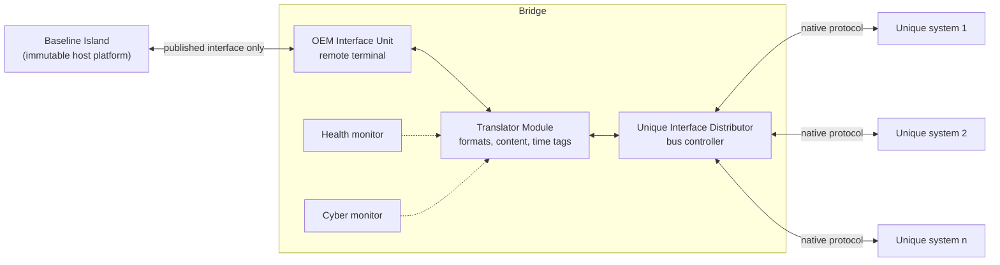

# bridge-island

A Python reference implementation of the **bridge/island integration architecture**.

A host platform that is certified by someone else and cannot be changed (the **Baseline
Island**) has to work with mission systems that you own and that change on their own
schedule (the **Unique Island**). In this architecture, every exchange between the two
islands goes through one mediation layer, the **Bridge**. When the baseline changes, the
change lands in the Bridge's mapping, not in every mission system. This package simulates
the pattern on invented platforms, compares it with point-to-point integration, and lets
you run, test and extend it.



!!! warning "Invented content, synthetic numbers"
    Every platform, message, field, rate and number in this project is invented. Experiment
    outputs are synthetic and illustrative. This is not flight or medical software, and it
    is not certified for any use. See [Design rationale and limitations](rationale.md).

## Quick start

From a checkout of the repository, with [uv](https://docs.astral.sh/uv/) installed:

```powershell
uv sync --all-groups
uv run bridge-island demo aviation
uv run bridge-island experiment change-impact --seed 1
```

The demo runs an invented aviation example on two versions of the baseline interface and
then compares what the change costs with point-to-point integration. The second command
reproduces the change-impact experiment, with a seeded Monte Carlo mode. Both finish in
seconds. Output (abridged):

```text
== baseline interface v2: 6 s simulated, seed 1 ==
subsystem        native bus         received  mean age  late  issues
CueingProcessor  label_words            1260    6.7 ms     0  baro_alt_m: unavailable (element removed from baseline interface v2)
REPORTED to the subsystem, not silent: AirData.baro_altitude_ft -> CueingProcessor.baro_alt_m: ...

                                     P2P  Bridge
  unique subsystems needing code change     3       1
  modules touched                           3       2
  tests failing before the fix              9       7
  components needing re-verification        3       2
```

## Where to go next

| If you want to | Read |
| --- | --- |
| Understand the pattern and the six guidelines | [Concepts](concepts.md) |
| Add your own mission system in about 15 minutes | [Tutorial](tutorial.md) |
| See the aviation and medical examples | [Examples](examples.md) |
| Reproduce the experiments | [Experiments](experiments.md) |
| Know what this does not claim | [Design rationale and limitations](rationale.md) |
| Cite the sources behind the pattern | [Related work](related-work.md) |
