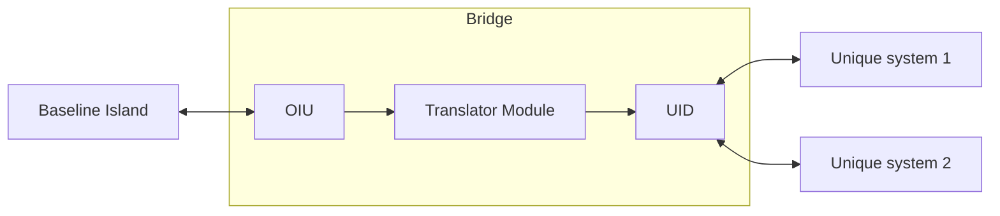

# bridge-island

A reference implementation of the bridge/island integration architecture, on invented
platforms. All content is invented; numbers are synthetic and illustrative.

*(Placeholder page. The full text arrives in Phase 6.)*
