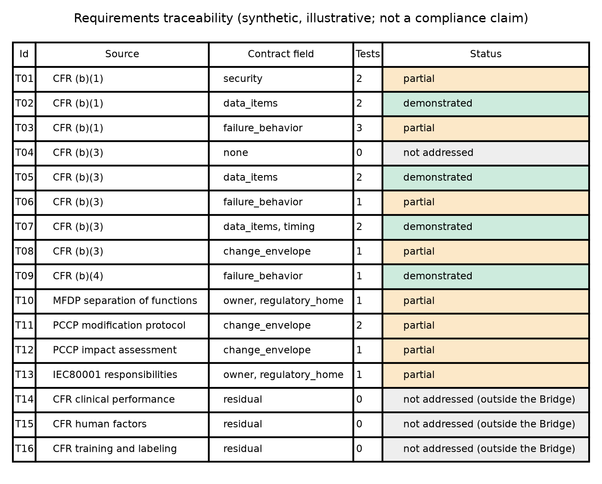

# Insulin loop: requirements traceability (RQ1)

!!! warning "An engineering illustration"
    This page is an engineering illustration on an invented example. It is
    not a regulatory submission and not a claim of compliance. Requirement texts are paraphrases, given with their
    section. The documents are cited by title only, and none of them endorses anything here.

Sources:

* 21 CFR 862.1356, *Interoperable automated glycemic controller*, special controls (b)(1), (b)(3) and
  (b)(4);
* FDA, *Multiple Function Device Products: Policy and Considerations* (July 2020);
* FDA, *Predetermined Change Control Plans for Medical Devices* (draft guidance, August 22, 2024);
* IEC 80001-1:2021, on the responsibilities when medical devices are connected to IT networks.

Each row gives the requirement (paraphrase and citation), the contract field it maps to, what the
Bridge does, the tests that check it, and a status:

* **demonstrated:** a test exists and passes;
* **partial:** some of the requirement is covered;
* **not addressed:** nothing here covers it.

`tests/test_traceability.py` fails if a row cites a test that does not exist or does not pass, or if
this table differs from `examples/insulin_loop_invented/traceability.yaml`.

Status counts:
<!-- ggl:traceability-counts:start -->
4 demonstrated, 8 partial, 1 not addressed, 3 not addressed (outside the Bridge)
<!-- ggl:traceability-counts:end -->

<!-- ggl:traceability:start -->
| Id | Requirement (paraphrase, citation) | Contract field | Bridge behaviour | Tests | Status |
| --- | --- | --- | --- | --- | --- |
| T01 | Secure and reliable transmission between the controller and connected devices. (CFR (b)(1)) | security | Only listed messages cross, only in their direction and from their listed senders; command replays and expired commands are blocked. No cryptographic authentication or encryption is modelled. | `test_security_blocks_unlisted_sender_and_direction` `test_replays_and_expired_commands_are_blocked` | partial |
| T02 | Specifications for the connected input devices and command devices the controller works with. (CFR (b)(1)) | data_items | Every crossing item has units, range, encoding and role in the contract; a conformance suite generated from it passes on each device set. | `test_the_shipped_contract_has_all_eight_sections` `test_the_conformance_suite_passes_on_every_device_set` | demonstrated |
| T03 | Safe therapy when communication is interrupted, lost or restored. (CFR (b)(1)) | failure_behavior | Lost, stale or out-of-range glucose gives the controller a FAILSAFE-flagged reading and holds the programmed basal until valid data reaches it again. While the Bridge itself is stalled it cannot do this; the host's watchdog and the pump's command expiry then carry the case. | `test_g7_every_loss_state_ends_in_failsafe` `test_property_no_unflagged_stale_glucose` `test_a_bridge_stall_fails_every_path_and_direct_has_nothing_to_stall` | partial |
| T04 | Validated interface specifications covering device pairing. (CFR (b)(3)) | none | Pairing is not modelled; devices are attached when the system is built. | none | not addressed |
| T05 | Validated interface specifications covering accurate transmission of data and commands. (CFR (b)(3)) | data_items | Units and encodings are converted by the compiled mapping (mmol/L to mg/dL, units to pump pulses) and checked by the conformance suite; a stale direct adapter is shown mis-dosing without it. | `test_a_stale_adapter_misdoses_a_new_pump_silently` `test_glucose_units_convert_with_the_stated_factor` | demonstrated |
| T06 | Validated interface specifications covering the sharing of state information. (CFR (b)(3)) | failure_behavior | The controller's status reaches the display; the controller is told when a command goes unconfirmed. Device state beyond confirmation (reservoir, battery) passes through without checks of its own. | `test_unconfirmed_command_retry_then_alarm` | partial |
| T07 | Continued safe operation when data arrive outside specified parameters. (CFR (b)(3)) | data_items, timing | Out-of-range, error-coded or too-old readings reach the controller only flagged FAILSAFE, including readings that aged in the queue to the controller. | `test_out_of_range_glucose_is_flagged` `test_old_glucose_is_flagged_and_fresh_glucose_recovers` | demonstrated |
| T08 | Validated interface specifications covering a software update mechanism. (CFR (b)(3)) | change_envelope | A declared peripheral change is checked against the envelope, with the conformance tests to re-run; how updates are delivered and installed is not modelled. | `test_envelope_decision_for_every_shipped_change` | partial |
| T09 | Critical event records covering commands and confirmations, malfunctions, alarms and acknowledgments, and connectivity lost and restored. (CFR (b)(4)) | failure_behavior | Each bridge-contract run exports a critical event record with all four groups. | `test_critical_events_cover_the_required_categories` | demonstrated |
| T10 | Separation of the device function under review from other functions, so that they can be assessed apart. (MFDP separation of functions) | owner, regulatory_home | The controller host stays unchanged; integration lives in one Bridge whose parts are separate partitions (G6). The separation is logical, inside one process. | `test_g1_to_g6_hold_for_the_insulin_loop` | partial |
| T11 | A modification protocol stating how planned changes are developed, verified and implemented. (PCCP modification protocol) | change_envelope | The envelope declares which peripheral changes are absorbed; the conformance suite generated from the contract is the verification for them. | `test_the_conformance_suite_is_generated_from_the_contract` `test_the_conformance_suite_passes_on_every_device_set` | partial |
| T12 | An impact assessment of the planned changes. (PCCP impact assessment) | change_envelope | The change ledger counts components, re-verification and sign-offs per change under a stated counting model. | `test_the_ledger_follows_its_counting_model` | partial |
| T13 | Defined responsibilities of the parties when medical devices are connected. (IEC80001 responsibilities) | owner, regulatory_home | The contract names its owner; each envelope decision names the organizations to involve and why. | `test_envelope_decision_for_every_shipped_change` | partial |
| T14 | Clinical data on the controller's performance. (CFR clinical performance) | residual | Outside the Bridge. | none | not addressed (outside the Bridge) |
| T15 | Human factors testing of the system and its alarms. (CFR human factors) | residual | Outside the Bridge. | none | not addressed (outside the Bridge) |
| T16 | Training and labeling for users. (CFR training and labeling) | residual | Outside the Bridge. | none | not addressed (outside the Bridge) |
<!-- ggl:traceability:end -->

## Reading the matrix

**Partial rows.** Most rows are partial, and that is the honest result. The Bridge structure gives
each requirement a place: a contract field, an owner and a test. Several requirements need more than
an interface can supply:

* cryptographic security;
* pairing;
* the delivery of software updates;
* a physical separation of functions.

**Rows outside the Bridge.** Clinical data, human factors, training and labeling are marked "not
addressed (outside the Bridge)". No integration architecture can supply them.

**No contradiction found.** None of the cited requirements contradicts the two-authority structure:

* the host keeps its own clearance and its own watchdogs;
* the integrator answers for the boundary;
* each peripheral maker answers for its device.

The FDA's draft guidance on predetermined change control plans describes, in its sample plan, adding
a wireless card and upgrading the operating system on a patient monitor. An envelope of declared
peripheral changes, each with generated conformance tests, is consistent with how such a plan is
described. It is not a plan, and nothing here computes a regulatory outcome.
