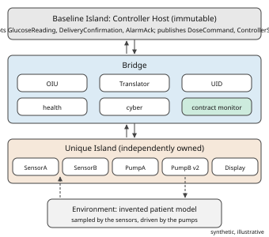
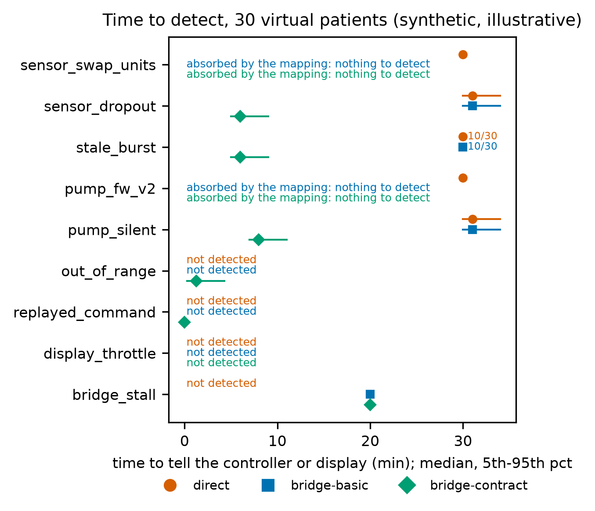
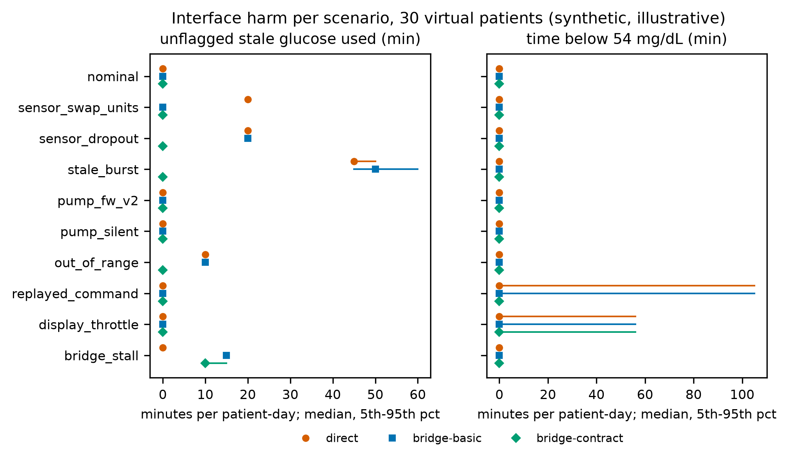
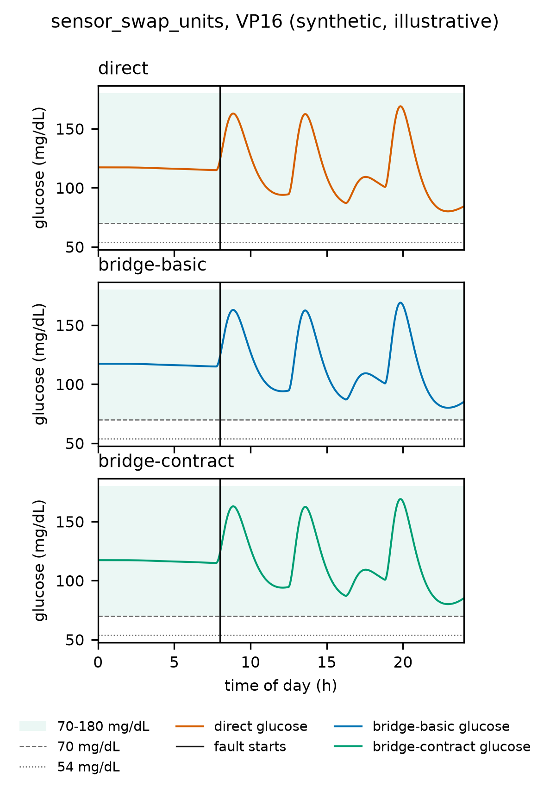
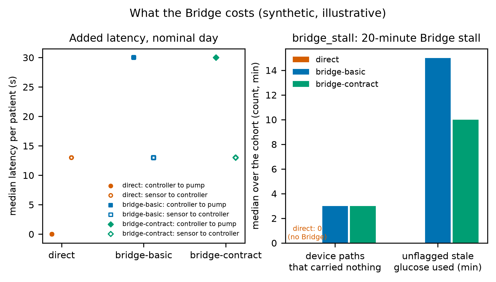

# Insulin loop: the Generic Glycemic Loop

!!! warning "Synthetic, illustrative"
    Everything on this page is invented: the devices, the organizations, the patient model, the
    controller and every number. This is not medical software. It is not a validated patient model
    or dosing algorithm, and it is not for clinical use. Regulatory and standards documents are
    cited by title only, and nothing here claims to comply with them.

## What it is, and why it exists

The Generic Glycemic Loop (`insulin-loop`) carries the bridge/island pattern into an interoperable
medical setting. An already-cleared dosing controller host cannot be changed by the integrator.
Sensors, pumps and a phone app come from other makers and change on their own schedules. The example
asks three questions, and makes each one runnable:

* **RQ1:** does the two-authority Bridge structure map onto interoperable-device requirements without
  contradiction? See the [traceability matrix](insulin-loop-traceability.md).
* **RQ2:** across realistic changes, does a Bridge reduce re-verification scope, and at what cost? See
  the change ledger in [Experiments](experiments.md#7-change-ledger).
* **RQ3:** does a runtime contract monitor at the Bridge detect boundary failures that direct
  integration misses? See the results below.

The costs of the Bridge are part of the answer: the latency it adds, its own verification burden,
and the fact that it is a single point of failure.



## The islands

| Part | Role | Invented details |
| --- | --- | --- |
| Controller Host | Baseline Island, immutable | Accepts `GlucoseReading`, `DeliveryConfirmation` and `AlarmAck`. Publishes `DoseCommand` every 5 minutes and `ControllerStatus` every minute. Interface v2 renames `iob`, sends basal in mU/min, adds `trend` and removes `loop_mode`. |
| SensorA | Unique Island | mg/dL every 5 minutes, label words, 7-minute lag |
| SensorB | Unique Island, another maker | mmol/L every minute, publish/subscribe, 5-minute lag, status as names |
| PumpA | Unique Island | Basal in U/h, bolus in U, confirms each command, command/response |
| PumpB firmware v2 | Unique Island | Renamed basal field, bolus in integer 0.05 U pulses, `reservoir_units` |
| CompanionDisplay | Unique Island, phone-like | Shows glucose and alarms and acknowledges alarms. The phone's operating system may hold it back. |
| Bridge | Between the islands | The OIU, Translator Module, UID, health and cyber monitors, plus the contract monitor |
| Patient model | Environment, outside both islands | The sensors sample it and the pumps drive it |

Three architectures run on the same patients, meals, seeds and faults:

* **direct:** each device has its own adapter on the host, written for the device version it was
  integrated with. The adapters have the same range and type checks as the Bridge's mapping.
* **bridge-basic:** the Bridge, translating only.
* **bridge-contract:** the Bridge with the contract monitor on.

## The patient model

The structure is the Bergman minimal model (Bergman, Ider, Bowden and Cobelli, 1979). It is extended
with a plasma-insulin compartment fed through two subcutaneous depots, and a two-compartment meal
absorption. Time is in minutes:

```text
dG/dt  = -(p1 + X) G + p1 Gb + Ra(t) / V        glucose, mg/dL
dX/dt  = -p2 X + p3 (I - Ib)                     remote insulin action, 1/min
dI/dt  = -n I + U2 / (tau_i VI)                  plasma insulin, uU/mL
dU1/dt = u(t) - U1 / tau_i                       insulin under the skin, uU
dU2/dt = (U1 - U2) / tau_i
dQ1/dt = -Q1 / tau_m + D(t)                      meal glucose, mg
dQ2/dt = (Q1 - Q2) / tau_m
Ra(t)  = f Q2 / tau_m
```

The equations are integrated with RK4 at a fixed 1-minute step, which keeps every run repeatable.
Without the subcutaneous depots, a bolus would act within minutes while a meal appears over hours,
and no meal bolus could match a meal. The virtual cohort is 30 parameter sets, `VP01` to `VP30`,
drawn from invented ranges and kept only if they settle back to rest.

<!-- ggl:cohort:start -->
Seed 1 drew 49 parameter sets and kept 30; 19 did not settle back to their resting glucose within 8 hours and were rejected.
<!-- ggl:cohort:end -->

**Its limits.** The parameter ranges are invented, not drawn from a population. There is no exercise,
no stress, no circadian change in sensitivity, no counter-regulation and no sensor calibration. The
model can be swapped behind the `PatientModel` protocol, so a validated simulator could be plugged in
without changing the Bridge. No such adapter exists here.

## The controller, and why it is not a real algorithm

The invented controller runs on the host every 5 minutes:

* it suspends basal below 80 mg/dL and gives the programmed basal up to 120 mg/dL;
* above 120 mg/dL it adds a proportional correction, held back by insulin on board;
* it gives a meal bolus for each announced meal;
* without a usable reading for 30 minutes it falls back to the programmed basal, and it raises its own
  alarms.

Its settings were tuned once, on the healthy-data day, so that no virtual patient goes below 54 mg/dL.
That keeps the comparisons about the interface. It is a teaching device, not a dosing method.

## The contract, G7 and G8

The contract (`examples/insulin_loop_invented/contract.yaml`) has eight parts, each enforced and
tested:

1. owner and regulatory home;
2. data items;
3. timing;
4. failure behaviour;
5. security;
6. claims linked to tests;
7. the change envelope;
8. the residual.

The app shows it as a [contract card](app.md#insulin-loop). Two guidelines are added for this example
only:

* **G7, clinical fail-safe first.** Every state in which the Bridge loses valid glucose ends in the
  contract's fail-safe output:
    * the controller gets a reading flagged FAILSAFE;
    * every command carries the patient's programmed basal until valid glucose reaches the
      controller again.
* **G8, degradation is visible.** Every fail-safe or alarm state reaches the display, or, if the
  display never acknowledges it, is logged as undelivered with its age.

Running the conformance suite found a real gap in the first version of the contract. A burst of late
readings could pass the Bridge fresh and then age in the queue toward the host. The contract now
checks age again at handover, and it flags a reading 90 seconds before the maximum age, because the
controller may read it up to a check period and a host frame later.

## The scenarios

| Scenario | What happens |
| --- | --- |
| `nominal` | No faults. It shows that the three architectures perform alike when nothing goes wrong. |
| `sensor_swap_units` | At 08:00 SensorA is replaced by SensorB. The direct adapter is not updated; the Bridge's mapping is, through the change envelope. |
| `sensor_dropout` | No readings for 45 minutes after lunch. |
| `stale_burst` | For 75 minutes, readings arrive in bursts, late, with their old sample times. |
| `pump_fw_v2` | At 08:00 PumpB v2 replaces PumpA. The direct adapter is not updated. |
| `pump_silent` | The pump stops confirming for an hour. In the second half it also stops delivering. |
| `out_of_range` | Three readings of 600 mg/dL marked OK, then three error codes. |
| `replayed_command` | The lunch bolus command is replayed 7 minutes after it was issued, still inside its validity. |
| `display_throttle` | The display is held back for 2 hours while glucose goes low (a lunch bolus for a meal mostly not eaten). |
| `bridge_stall` | The Bridge itself stops for 20 minutes. |

## Results

Over 30 virtual patients and 24 hours, seed 1. **Told** means the controller or the display was
told: a host watchdog alarm, a fail-safe flag, an unconfirmed report, or an annunciation shown on the
display. Times are measured from the start of the fault.

<!-- ggl:closed-loop:start -->
| Scenario | Architecture | Minutes in 70-180 mg/dL, median [p5, p95] | Patients below 54 | Told: patients, time median [p5, p95] | Patients acting on unflagged stale glucose | Unit or encoding errors through | Alarms late / lost |
| --- | --- | --- | --- | --- | --- | --- | --- |
| nominal | direct | 1278 [1149, 1440] | 0 | no fault | 0 | 0 | 0 / 0 |
| nominal | bridge-basic | 1278 [1149, 1440] | 0 | no fault | 0 | 0 | 0 / 0 |
| nominal | bridge-contract | 1278 [1149, 1440] | 0 | no fault | 0 | 0 | 0 / 0 |
| sensor_swap_units | direct | 1277 [1117, 1440] | 0 | 30 of 30, 1800 [1800, 1800] s | 30 | 0 | 0 / 0 |
| sensor_swap_units | bridge-basic | 1277 [1157, 1440] | 0 | 0 of 30 | 0 | 0 | 0 / 0 |
| sensor_swap_units | bridge-contract | 1277 [1157, 1440] | 0 | 0 of 30 | 0 | 0 | 0 / 0 |
| sensor_dropout | direct | 1277 [1147, 1440] | 0 | 30 of 30, 1860 [1800, 2040] s | 30 | 0 | 0 / 1 |
| sensor_dropout | bridge-basic | 1277 [1147, 1440] | 0 | 30 of 30, 1860 [1800, 2040] s | 30 | 0 | 0 / 1 |
| sensor_dropout | bridge-contract | 1277 [1147, 1440] | 0 | 30 of 30, 360 [300, 540] s | 0 | 0 | 0 / 1 |
| stale_burst | direct | 1278 [1149, 1440] | 0 | 10 of 30, 1800 [1800, 1800] s | 30 | 0 | 0 / 0 |
| stale_burst | bridge-basic | 1278 [1149, 1440] | 0 | 10 of 30, 1800 [1800, 1800] s | 30 | 0 | 0 / 0 |
| stale_burst | bridge-contract | 1278 [1149, 1440] | 0 | 30 of 30, 360 [300, 540] s | 0 | 0 | 0 / 0 |
| pump_fw_v2 | direct | 882 [689, 1147] | 0 | 30 of 30, 1800 [1800, 1800] s | 0 | 5760 | 0 / 0 |
| pump_fw_v2 | bridge-basic | 1279 [1149, 1440] | 0 | 0 of 30 | 0 | 0 | 0 / 0 |
| pump_fw_v2 | bridge-contract | 1279 [1149, 1440] | 0 | 0 of 30 | 0 | 0 | 0 / 0 |
| pump_silent | direct | 1278 [1149, 1440] | 0 | 30 of 30, 1860 [1800, 2040] s | 0 | 0 | 0 / 0 |
| pump_silent | bridge-basic | 1278 [1149, 1440] | 0 | 30 of 30, 1860 [1800, 2040] s | 0 | 0 | 0 / 0 |
| pump_silent | bridge-contract | 1278 [1149, 1440] | 0 | 30 of 30, 480 [420, 660] s | 0 | 0 | 0 / 0 |
| out_of_range | direct | 1278 [1149, 1440] | 0 | 0 of 30 | 30 | 0 | 0 / 0 |
| out_of_range | bridge-basic | 1278 [1149, 1440] | 0 | 0 of 30 | 30 | 0 | 0 / 0 |
| out_of_range | bridge-contract | 1278 [1149, 1440] | 0 | 30 of 30, 77 [17, 257] s | 0 | 0 | 0 / 0 |
| replayed_command | direct | 1260 [1076, 1399] | 6 | 0 of 30 | 0 | 0 | 0 / 0 |
| replayed_command | bridge-basic | 1260 [1076, 1397] | 6 | 0 of 30 | 0 | 0 | 0 / 0 |
| replayed_command | bridge-contract | 1278 [1149, 1440] | 0 | 30 of 30, 0 [0, 0] s | 0 | 0 | 0 / 0 |
| display_throttle | direct | 1311 [1101, 1418] | 2 | 0 of 30 | 0 | 0 | 15 / 0 |
| display_throttle | bridge-basic | 1311 [1101, 1418] | 2 | 0 of 30 | 0 | 0 | 15 / 0 |
| display_throttle | bridge-contract | 1311 [1101, 1418] | 2 | 0 of 30 | 0 | 0 | 27 / 0 |
| bridge_stall | direct | 1278 [1149, 1440] | 0 | 0 of 30 | 0 | 0 | 0 / 0 |
| bridge_stall | bridge-basic | 1278 [1149, 1440] | 0 | 30 of 30, 1200 [1200, 1200] s | 30 | 0 | 0 / 0 |
| bridge_stall | bridge-contract | 1278 [1149, 1440] | 0 | 30 of 30, 1200 [1200, 1200] s | 30 | 0 | 0 / 0 |
<!-- ggl:closed-loop:end -->





Fig. 2 shows the patient with the median difference between architectures, not the most dramatic
one. For that patient, direct's fallback to the programmed basal after the sensor swap gives nearly
the same day as the Bridge.

**What the table says.**

* **Nominal day.** Glucose is the same in all three architectures.
* **Stale data.** In `stale_burst` and `sensor_dropout`, the contract tells the controller within
  minutes, and no controller cycle uses unflagged stale glucose. Direct and bridge-basic act on old
  readings until the host's 30-minute watchdog; in `stale_burst` that watchdog is never reached for
  most patients.
* **A stale adapter.** It mis-doses a new pump firmware on every command, without a word. One mapping
  entry on the Bridge absorbs the change.
* **Replays.** A replayed bolus command goes through direct and bridge-basic. Only the contract's
  command-id check blocks it.
* **Display throttling.** The Bridge cannot fix it: alarms arrive late in every architecture. The
  contract only makes the lateness visible, as G8 requires.

## The costs, and the single point of failure

<!-- ggl:costs:start -->
| Architecture | Controller to pump (s), nominal | Sensor to controller (s), nominal | Unneeded fail-safe minutes, nominal (median) | Device paths dead in a 20-min stall (median) | Unflagged stale-glucose minutes in the stall |
| --- | --- | --- | --- | --- | --- |
| direct | 0 [0, 0] | 13 [13, 13] | 0.0 | 0 | 0 [0, 0] |
| bridge-basic | 30 [30, 30] | 13 [13, 13] | 0.0 | 3 | 15 [15, 15] |
| bridge-contract | 30 [30, 30] | 13 [13, 13] | 0.0 | 3 | 10 [10, 15] |
<!-- ggl:costs:end -->



**Latency.** The Bridge adds one bus hop, a 30-second frame on the command path.

**Bridge stall.** When the Bridge stalls, every device path stops at once, and the contract stalls
with it. The controller then uses unflagged stale glucose until the Bridge resumes, and the health
monitor reports the stall only afterwards. What still works:

* the pump falls back to its programmed basal when its last command expires;
* the host's own watchdogs still run.

Direct has nothing to stall and does better here. Detection is not tolerance: a real Bridge would
need redundancy and its own safety case, and none is modelled.

## Limitations and threats to validity

* **Invented physiology.** The model is a teaching structure with invented parameters. The glucose
  outcomes only show that the interface effects reach the patient model; they are not clinical
  results.
* **Invented controller.** It was tuned on the healthy-data day so that the comparisons isolate the
  interface. A different controller would react differently to the same faults: for example, one
  that checks reading age itself would close much of the stale-data gap.
* **The counting model.** The change ledger counts what a stated model says, not what any organization
  measured. A [sensitivity table](experiments.md#7-change-ledger) shows the direct case with adapters
  living in the devices.
* **Symmetric adapter checks.** Direct adapters have the range and type checks a competent integrator
  would write. They have no age, command-id or confirmation checks; adding those to direct would
  narrow the RQ3 differences. The design note records the choice.
* **Single implementation.** One author wrote all three architectures on simplified bus models with no
  clock drift, jitter or loss.

See also the [design note](dev/insulin-loop-design.md) for every place the specification and the
code disagreed.
